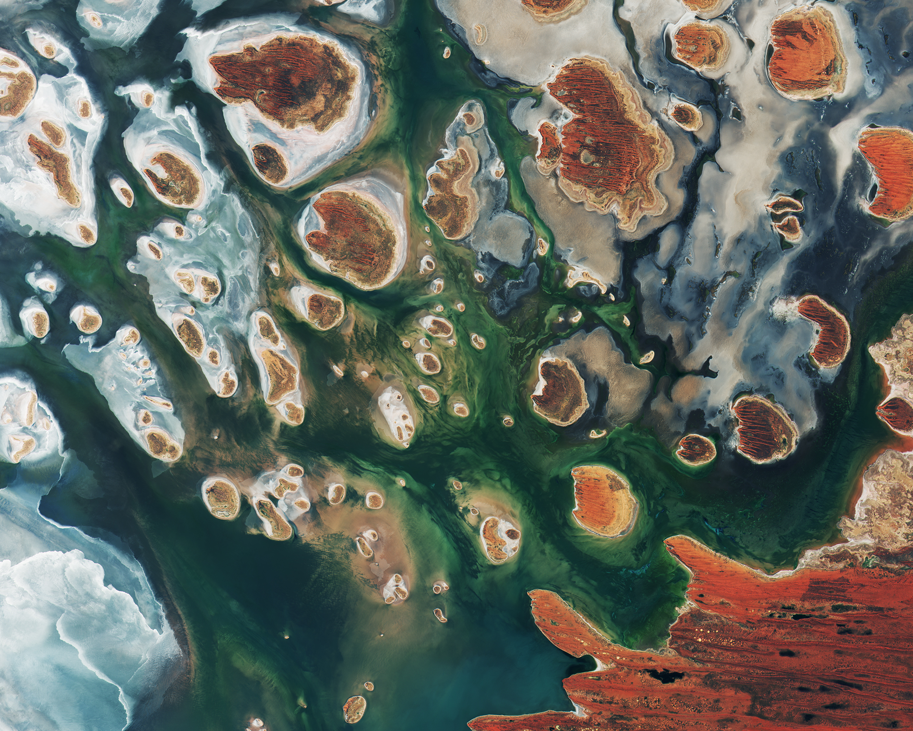

Satellite imagery can be enormous. A single high-resolution satellite scene may occupy several gigabytes, making it inefficient to download an entire file when only a small geographic region is needed. Imagine working with a 20 GB satellite image stored in the cloud. Your application needs to display or analyze only a small portion of it.

**Do you really need to download all 20 GB?**

Not necessarily.

This is where **Cloud Optimized GeoTIFFs (COGs)** come in.

## Understanding TIFF and GeoTIFF

[TIFF (Tagged Image File Format)](https://en.wikipedia.org/wiki/TIFF) is a flexible raster image format that supports multiple bands, different data types, and various compression methods. A [GeoTIFF](https://www.ogc.org/standard/geotiff/) extends TIFF by including geospatial metadata, allowing GIS software to determine where the image belongs on Earth.

This information typically includes:

- Coordinate Reference System (CRS)
- Geographic extent and pixel resolution
- Information needed to transform image coordinates into geographic coordinates

GeoTIFF is widely used in remote sensing and geospatial applications because it combines raster data and spatial referencing in a single file. However, **a conventional GeoTIFF is not necessarily organized for efficient access over the internet**.

## What is a Cloud Optimized GeoTIFF?

A [Cloud Optimized GeoTIFF (COG)](https://www.cogeo.org/) is a GeoTIFF whose internal structure is optimized for efficient access to selected portions of the file over the internet. Rather than downloading an entire raster, applications can retrieve only the bytes required to access a particular geographic region or resolution. This makes COGs particularly useful for large satellite datasets stored on HTTP-accessible servers or object storage services such as Amazon S3.

Three key mechanisms make this possible:

1. **Internal tiling:** Organizes raster data into independently accessible blocks.
2. **Internal overviews:** Stores reduced-resolution representations of the image.
3. **HTTP range requests:** Allows clients to retrieve selected byte ranges from a remote file.

Let's explore each of these.

## 1. Internal Tiling

Raster images can be organized internally into strips or tiles. In a tiled GeoTIFF, the image is divided into smaller rectangular blocks, commonly 256 × 256 or 512 × 512 pixels. Suppose we have a satellite image covering an entire country, but we're interested in a small urban area. With a properly organized COG, a compatible application can identify which tiles contain the requested area and retrieve the corresponding portions of the file. This avoids transferring unrelated image data.

For example:

```text
                 Satellite Image
              ┌───────────────────┐
              │   │   │   │   │   │
              │───┼───┼───┼───┼───│
              │   │   │███│   │   │
              │───┼───┼███┼───┼───│
              │   │   │   │   │   │
              │───┼───┼───┼───┼───│
              │   │   │   │   │   │
              └───────────────────┘

              █ = Required image tile
```

Instead of transferring the entire raster, the application can request only the blocks needed for the selected area. This is particularly useful for applications that frequently access spatial subsets of large satellite images.

## 2. Internal Overviews

When viewing satellite imagery on a web map, we rarely need the full-resolution image at every zoom level. For example, displaying a 10 m resolution satellite image at a continental scale would be inefficient. **Overviews** solve this problem by storing progressively downsampled versions of the original image.

A typical overview pyramid might contain images at:

- 1/2 of the original width and height
- 1/4 of the original width and height
- 1/8 of the original width and height
- 1/16 of the original width and height

When a user zooms out, the application can access an appropriate overview instead of reading the full-resolution raster. This reduces the amount of data transferred and processed. Internal overviews are particularly valuable for interactive web mapping, where users frequently zoom between different geographic scales.

## 3. HTTP Range Requests

[HTTP range requests](https://developer.mozilla.org/en-US/docs/Web/HTTP/Range_requests) allow clients to request specific byte ranges from a remotely hosted file.

For example:

```http
GET /satellite-image.tif HTTP/1.1
Host: example.com
Range: bytes=0-16383
```

Instead of returning the entire file, a server supporting byte-range requests can return only the requested bytes. A successful partial-content response typically uses the HTTP status code `206 Partial Content`. For COGs, this capability is especially important. A compatible geospatial application can:

1. Read the file's metadata to identify the location of image blocks.
2. Determine which blocks correspond to the requested geographic region.
3. Send HTTP range requests for the relevant portions of the file.
4. Decode and process the retrieved raster data.

**The key advantage is that the application can access a spatial subset without downloading the entire raster.** However, two conditions are important:

- The server must support HTTP range requests.
- The application must understand the COG's internal organization.

## Why Are COGs Useful?

### Efficient access to large satellite datasets

COGs allow applications to retrieve selected geographic regions or overview levels instead of downloading complete satellite scenes. This is particularly valuable when working with large collections of Earth observation imagery.

### Cloud-native geospatial workflows

COGs can be stored in cloud object storage and accessed directly by compatible geospatial applications. For example, GDAL can read a remotely hosted COG using its `/vsicurl/` virtual filesystem without first downloading the complete file.

### Reduced data movement

Multiple applications can access the same remotely hosted raster dataset. This can reduce unnecessary downloads and the need to maintain duplicate local copies. Applications may still use caching or intermediate datasets, depending on their processing requirements.

### On-the-fly visualization and processing

COGs are particularly useful for services that dynamically generate map tiles or process selected geographic regions. For example, a web mapping service can retrieve a spatial subset from a COG and generate a visualization without processing the entire source image. The COG provides efficient data access, while the application performs the actual processing.

## Converting a GeoTIFF to a Cloud Optimized GeoTIFF

GDAL provides a dedicated driver for creating Cloud Optimized GeoTIFFs. With GDAL 3.1 or newer, you can convert an existing GeoTIFF using:

```bash
gdal_translate input.tif output_cog.tif \
  -of COG \
  -co COMPRESS=DEFLATE \
  -co BLOCKSIZE=512 \
  -co OVERVIEWS=AUTO
```

Let's understand the options:

| Option | Description |
|---|---|
| `-of COG` | Uses GDAL's Cloud Optimized GeoTIFF driver |
| `COMPRESS=DEFLATE` | Enables lossless compression |
| `BLOCKSIZE=512` | Sets the internal tile dimensions to 512 × 512 pixels |
| `OVERVIEWS=AUTO` | Uses suitable existing overviews or generates them when needed |

The COG driver handles the internal file organization required for efficient remote access.

### What about the traditional approach?

Before GDAL introduced its dedicated COG driver, a common approach involved generating overviews and creating a tiled GeoTIFF.

For example:

```bash
gdaladdo -r average input.tif 2 4 8 16
```

Followed by:

```bash
gdal_translate input.tif output.tif \
  -co TILED=YES \
  -co COPY_SRC_OVERVIEWS=YES \
  -co COMPRESS=LZW
```

Although this produces a tiled, compressed GeoTIFF with overviews, it does not automatically guarantee that the output satisfies all COG layout requirements. **For new workflows, the dedicated COG driver is the recommended approach.**

## Reading a Remote COG with GDAL

One of the main advantages of COGs is the ability to access them remotely. GDAL provides the `/vsicurl/` virtual filesystem for reading HTTP-accessible files.

For example:

```bash
gdalinfo /vsicurl/https://example.com/satellite-image.tif
```

This allows GDAL to inspect a remotely hosted GeoTIFF without first downloading it as a complete local file. You can also request a spatial subset using `gdal_translate`.

For example:

```bash
gdal_translate \
  /vsicurl/https://example.com/satellite-image.tif \
  subset.tif \
  -srcwin 1000 1000 512 512
```

Here, `-srcwin` specifies the pixel offset and dimensions of the requested window:

```text
-srcwin <x_offset> <y_offset> <width> <height>
```

For a properly organized COG, GDAL can retrieve the relevant image blocks using HTTP range requests. The amount of data transferred depends on factors such as tile size, compression, requested bands, and caching.

## Validating a COG

After conversion, you can inspect the output using:

```bash
gdalinfo output_cog.tif
```

This provides information about the raster dimensions, coordinate reference system, bands, compression, and overviews. However, inspecting the metadata alone does not establish full COG compliance.

For more thorough validation, use a dedicated COG validator, such as GDAL's `validate_cloud_optimized_geotiff.py` utility.

```bash
python validate_cloud_optimized_geotiff.py output_cog.tif
```

The validator script must be installed or available in your environment.

## Closing Thoughts

Cloud Optimized GeoTIFFs are an important building block for cloud-native geospatial systems. They don't introduce an entirely new raster format. Instead, they organize existing GeoTIFF capabilities to make remote access more efficient. By combining internal tiling, overviews, and HTTP range requests, COGs make it possible to work with large satellite datasets without repeatedly downloading entire files. For applications involving Earth observation, geospatial analytics, and web-based mapping, this can significantly simplify data access and reduce unnecessary data transfer.

## Presentation: Introduction to Cloud Optimized GeoTIFF

I presented an introduction to Cloud Optimized GeoTIFFs at the first **DataPub event organized by TimescaleDB in March 2020**. The presentation covers the underlying concepts and their relevance to cloud-native geospatial data workflows.

<iframe
  width="100%"
  height="450"
  src="https://www.youtube.com/embed/62OD60PfBUE"
  title="Introduction to Cloud Optimized GeoTIFF — DataPub"
  frameBorder="0"
  allow="accelerometer; autoplay; encrypted-media; gyroscope; picture-in-picture"
  allowFullScreen
></iframe>