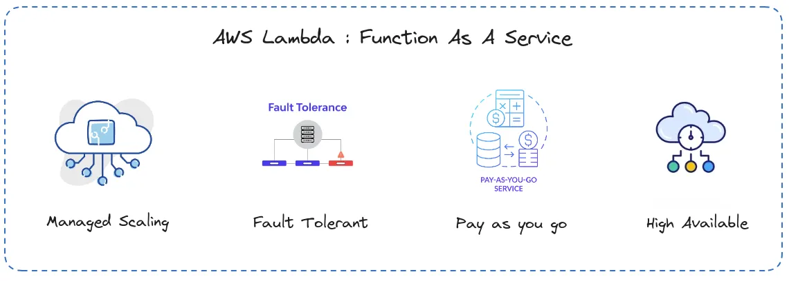
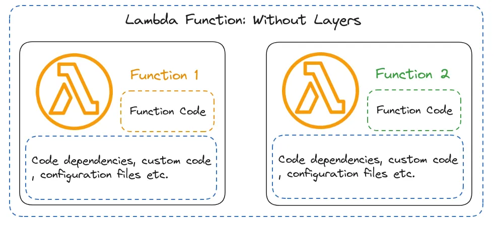
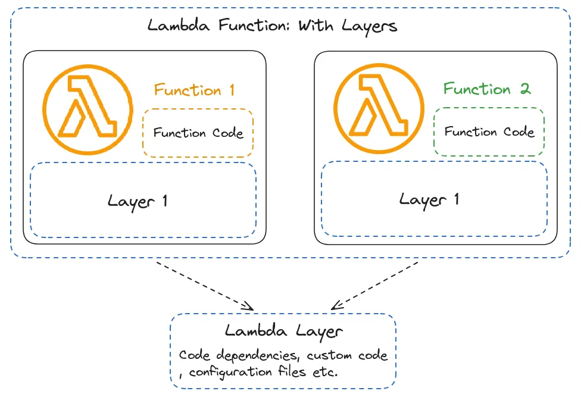
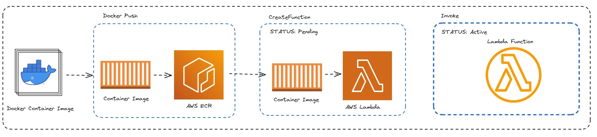

AWS Lambda has transformed how developers build and deploy applications in the cloud. Instead of provisioning and maintaining servers, developers can run code in response to events while AWS manages the underlying infrastructure. However, serverless computing introduces its own challenges, particularly when applications depend on large libraries, compiled extensions, or system-level dependencies. This becomes especially relevant in **geospatial data processing**, where libraries such as GDAL, Rasterio, Fiona, and GeoPandas often depend on native binaries and shared libraries. In this article, we'll explore how AWS Lambda evolved from ZIP-based deployment packages to container images, and why this transition made deploying geospatial applications considerably easier.



## 1. The Early Days of AWS Lambda

AWS Lambda was introduced in 2014 as an event-driven compute service. The idea was straightforward: developers could upload their code, configure an event trigger, and let AWS execute the function when needed. A typical Lambda workflow might look like this:

```text
        Event Source
             |
             v
        AWS Lambda
             |
             v
       Execute Function
             |
             v
       Return / Store Result
```

For example, an application could trigger a Lambda function whenever a new satellite image was uploaded to an Amazon S3 bucket. The function could then inspect the file, extract metadata, or initiate a larger processing workflow.

### Lambda's Resource Constraints

Lambda functions operate within defined resource limits. These limits have evolved considerably since the service was introduced. Some important milestones include:

| Resource | Earlier Limit | Later Capability |
|---|---|---|
| Memory | 128 MB at launch | Up to 10,240 MB |
| Execution timeout | 60 seconds at launch | Up to 15 minutes |
| Temporary storage | 512 MB | Configurable up to 10,240 MB |
| ZIP deployment | Limited deployment size | 250 MB unzipped, including layers |
| Container images | Not initially supported | Up to 10 GB uncompressed image size |

The expanded limits made Lambda suitable for increasingly complex workloads. However, packaging dependencies remained a significant challenge.



## 2. Deploying Lambda Functions Using ZIP Packages

The traditional way to deploy a Lambda function is to package its Python code and dependencies into a ZIP archive. For a simple function, this process is straightforward. Consider a Python Lambda function that uses Pandas.

### Step 1: Install Dependencies

Create a directory to hold the required Python packages:

```bash
mkdir package

pip3 install \
  --target ./package \
  pandas
```

### Step 2: Create the Deployment Archive

Package the installed dependencies:

```bash
cd package

zip -r ../my_deployment_package.zip .

cd ..
```

Then add the Lambda handler:

```bash
zip my_deployment_package.zip lambda_function.py
```

The resulting archive contains the application code and its dependencies.

For example:

```text
my_deployment_package.zip
|
|-- lambda_function.py
|-- pandas/
|-- numpy/
|-- dateutil/
|-- pytz/
|-- ...
```

### Step 3: Deploy Using the AWS CLI

The function can be created using the AWS CLI:

```bash
aws lambda create-function \
  --function-name myFunction \
  --runtime python3.12 \
  --handler lambda_function.lambda_handler \
  --role arn:aws:iam::111122223333:role/service-role/my-lambda-role \
  --zip-file fileb://my_deployment_package.zip
```

Here:

- `--runtime` specifies the Python runtime.
- `--handler` identifies the function entry point.
- `--role` specifies the IAM execution role.
- `--zip-file` provides the deployment package.

For packages uploaded directly through the Lambda API, the compressed ZIP size is limited to 50 MB. Larger ZIP archives can be uploaded through Amazon S3, subject to Lambda's unzipped package limits.

### The Challenge with Geospatial Libraries

This approach becomes more complicated when applications require compiled libraries.

For example:

- GDAL
- Rasterio
- Fiona
- GeoPandas
- NumPy

These packages may depend on native libraries that must be compatible with the Lambda execution environment. Installing them on a local development machine does not necessarily produce binaries compatible with AWS Lambda. For geospatial applications, this often means building dependencies in an environment that matches the Lambda runtime. Additionally, the combined unzipped size of the function package and its layers must remain within Lambda's deployment limits. This can make packaging and deployment considerably more difficult.

## 3. Lambda Layers



AWS introduced Lambda Layers to make it easier to share libraries and dependencies across multiple functions. Instead of packaging the same dependencies into every function, developers can publish them as a separate layer. A Lambda function can then reference the layer during execution.

### Creating a Python Layer

Python layers must follow a specific directory structure. For example:

```text
layer/
|
|-- python/
    |-- pandas/
    |-- numpy/
    |-- dateutil/
    |-- ...
```

Create the directory and install dependencies:

```bash
mkdir -p layer/python

pip3 install \
  --target ./layer/python \
  pandas
```

Create the ZIP archive:

```bash
cd layer

zip -r ../layer.zip python

cd ..
```

The layer can then be published using the AWS CLI:

```bash
aws lambda publish-layer-version \
  --layer-name my-python-layer \
  --description "Python dependencies" \
  --zip-file fileb://layer.zip \
  --compatible-runtimes python3.12
```

For larger archives, the layer can first be uploaded to Amazon S3.

### Why Use Lambda Layers?

Layers provide several advantages:

- Dependencies can be shared across multiple Lambda functions.
- Application code can be deployed independently of shared libraries.
- Common dependencies can be maintained in a separate package.
- Function deployment archives can remain smaller.

However, layers do not eliminate Lambda's package size restrictions. The combined unzipped size of the function and its layers must still remain within the applicable limit. For applications involving GDAL and other native dependencies, creating compatible layers can also require additional build steps. This is where container images become particularly useful.

## 4. AWS Lambda Introduces Container Image Support



In December 2020, AWS introduced support for deploying Lambda functions as container images. This was a significant development for applications with complex dependency requirements. Instead of assembling a ZIP package, developers could build a container image containing their application code, Python dependencies, and required system libraries. The image could then be stored in **Amazon Elastic Container Registry (ECR)** and deployed to Lambda.

A typical deployment workflow looks like this:

```text
       Application Code
              |
              v
          Dockerfile
              |
              v
       Build Container
              |
              v
         Amazon ECR
              |
              v
          AWS Lambda
```

Container images support an uncompressed image size of up to 10 GB. This provides substantially more room for applications requiring large dependencies. However, Lambda functions deployed as container images still operate within Lambda's execution, memory, storage, and other service limits.

## 5. Building a Lambda Container Image

AWS provides base images that include supported language runtimes and the components required to run applications on Lambda. For example, a Python Lambda function can be packaged using the official AWS Python base image.

### Example Lambda Function

Create a file named `lambda_function.py`:

```python
def lambda_handler(event, context):

    return {
        "statusCode": 200,
        "body": "Hello from AWS Lambda!"
    }
```

### Dockerfile

Create a `Dockerfile`:

```dockerfile
FROM public.ecr.aws/lambda/python:3.12

COPY requirements.txt ${LAMBDA_TASK_ROOT}/

RUN pip install \
    -r ${LAMBDA_TASK_ROOT}/requirements.txt \
    --target ${LAMBDA_TASK_ROOT}

COPY lambda_function.py ${LAMBDA_TASK_ROOT}/

CMD ["lambda_function.lambda_handler"]
```

The `CMD` instruction specifies the handler that Lambda should invoke. Since the application file is named `lambda_function.py`, the handler is:

```text
lambda_function.lambda_handler
```

### Build the Image

```bash
docker build -t pylambda .
```

When deploying to Lambda, build the image for the intended architecture, such as `linux/amd64` or `linux/arm64`.

### Test Locally

Run the container:

```bash
docker run -p 9000:8080 pylambda:latest
```

In another terminal, invoke the function:

```bash
curl -X POST \
  "http://localhost:9000/2015-03-31/functions/function/invocations" \
  -H "Content-Type: application/json" \
  -d '{"test": "value"}'
```

The container uses the Lambda Runtime Interface Emulator provided by the AWS base image to support local invocation. This makes it possible to test the basic function behavior before deployment.

## 6. Why Container Images Matter for Geospatial Applications

One of the biggest advantages of container images is the ability to control the application environment. Geospatial processing applications frequently depend on libraries such as:

- GDAL for raster and vector data processing.
- Rasterio for raster I/O.
- GeoPandas for vector geospatial operations.
- Fiona and PyProj for geospatial data access and coordinate transformations.
- NumPy and Pandas for numerical and tabular processing.

These dependencies can be difficult to package into traditional Lambda ZIP archives. With Docker, developers can install compatible system libraries and Python packages during the image build process. This improves reproducibility and makes the deployment environment easier to maintain.

### Using a Custom Container Image

AWS Lambda also supports custom container images. For Python applications, a custom image must include the Lambda Runtime Interface Client, which enables communication between the Lambda runtime and the service. The Python implementation is available through the `awslambdaric` package. For example, a custom container can use:

```dockerfile
ENTRYPOINT ["python", "-m", "awslambdaric"]

CMD ["lambda_function.lambda_handler"]
```

The container must also include the application code, dependencies, and a compatible Python environment. When using custom images for geospatial workloads, special attention should be paid to:

- GDAL and Python binding compatibility.
- Required native shared libraries.
- Container architecture.
- Lambda runtime compatibility.
- Filesystem permissions.
- Application memory and temporary storage requirements.

Container images simplify packaging, but they do not automatically solve binary compatibility issues.

### Geospatial Container Images

Projects such as [Lambgeo](https://github.com/lambgeo) and the [OSGeo GDAL Docker images](https://github.com/OSGeo/gdal/tree/master/docker) have provided useful starting points for building geospatial processing environments. These images and projects can help developers understand how to package native geospatial dependencies. However, a general-purpose GDAL image is not automatically compatible with Lambda. It must satisfy Lambda's container runtime requirements and include the necessary runtime interface components. Older images should also be checked for supported Python versions, system libraries, and security updates.

## 7. Deploying a Container Image Through Amazon ECR

Once the Docker image is built, it can be pushed to Amazon ECR.

### Step 1: Authenticate Docker with ECR

```bash
aws ecr get-login-password \
  --region your-region \
  | docker login \
      --username AWS \
      --password-stdin \
      your-account-id.dkr.ecr.your-region.amazonaws.com
```

### Step 2: Tag the Image

Assuming an ECR repository named `pygeolambda` already exists:

```bash
docker tag pylambda:latest \
  your-account-id.dkr.ecr.your-region.amazonaws.com/pygeolambda:latest
```

### Step 3: Push the Image

```bash
docker push \
  your-account-id.dkr.ecr.your-region.amazonaws.com/pygeolambda:latest
```

### Step 4: Create the Lambda Function

```bash
aws lambda create-function \
  --function-name my-lambda-function \
  --package-type Image \
  --code ImageUri=your-account-id.dkr.ecr.your-region.amazonaws.com/pygeolambda:latest \
  --role arn:aws:iam::111122223333:role/service-role/my-lambda-role \
  --timeout 30 \
  --memory-size 512
```

The IAM execution role must have the appropriate permissions, and Lambda must be able to access the ECR image. For an existing function, a new image can be deployed using:

```bash
aws lambda update-function-code \
  --function-name my-lambda-function \
  --image-uri your-account-id.dkr.ecr.your-region.amazonaws.com/pygeolambda:latest
```

One important consideration is that Lambda resolves an image tag to a specific image digest when the function is deployed. Pushing a new image to the same ECR tag does not automatically update an existing Lambda function. The function code must be updated explicitly.

## 8. ZIP Packages vs. Container Images

Both deployment approaches remain supported by AWS Lambda. The appropriate choice depends on the application's requirements.

| Feature | ZIP Package | Container Image |
|---|---|---|
| Deployment format | ZIP archive | OCI-compatible container image |
| Maximum package size | 250 MB unzipped, including layers | 10 GB uncompressed |
| Dependency management | Python packages and Lambda Layers | Dockerfile and container image |
| Native dependencies | Requires compatible binaries and packaging | Can include compatible system libraries |
| Image registry | Not required | Amazon ECR |
| Local testing | Possible using Lambda tooling | Possible using container tooling |
| Suitable for | Small and relatively simple functions | Functions with larger or more complex dependencies |

For lightweight functions, ZIP deployment is often sufficient. For applications involving GDAL, Rasterio, and other compiled geospatial libraries, container images can offer a more manageable deployment process. However, larger images may introduce additional build, storage, and maintenance overhead.

## 9. When Should You Use AWS Lambda for Geospatial Processing?

Lambda can be useful for event-driven geospatial workflows.

For example:

- Extracting metadata when a new satellite image arrives in S3.
- Validating uploaded raster files.
- Generating lightweight image previews.
- Processing small geographic subsets.
- Triggering downstream processing pipelines.
- Running short geospatial transformations.

However, Lambda is not always the right choice. Large-scale raster processing, long-running algorithms, or memory-intensive workloads may be better suited to services such as AWS Batch or container-based compute infrastructure. A common architecture is to use Lambda for event handling and orchestration while delegating computationally intensive processing to other services.

## Conclusion

AWS Lambda has evolved considerably since its introduction in 2014. The service began with a relatively simple model for executing event-driven functions and gradually expanded its runtime capabilities, resource limits, and deployment options. The introduction of Lambda Layers improved dependency sharing, while container image support made it easier to package applications requiring complex libraries and native dependencies. For geospatial applications, this is particularly valuable. Libraries such as GDAL and Rasterio can be difficult to package into traditional ZIP archives, whereas container images provide greater control over the runtime environment. **The main advantage of container images is not simply their larger size limit, but the ability to build reproducible application environments with complex dependencies.** For developers building cloud-native geospatial processing systems, understanding these deployment options helps in selecting the appropriate approach for each workload.
