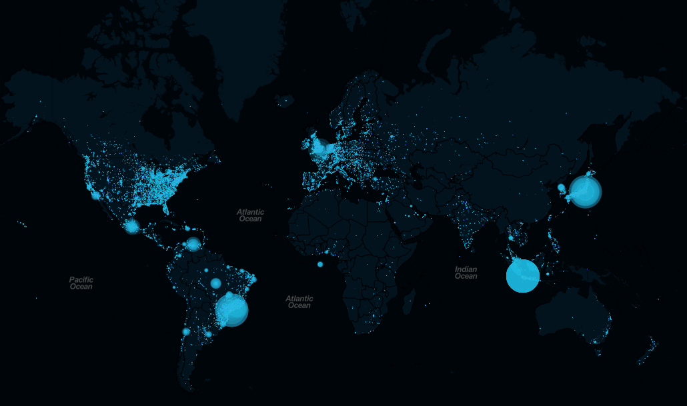
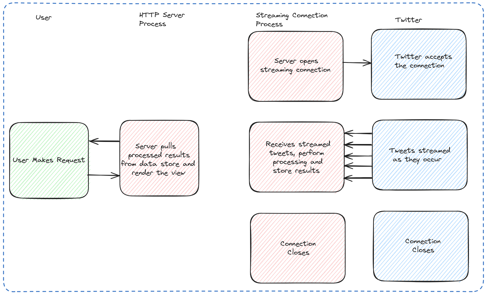

## Introduction

What if we could visualize conversations happening around the world as they occur?

In this project, I built a web application that collects geotagged tweets and displays their locations on an interactive world map in near real time. The application uses Python to connect to the Twitter Streaming API, processes incoming tweets into GeoJSON, and serves the resulting data through a Flask application. On the frontend, Leaflet displays the geographic locations of tweets on a map.

The project combines several technologies:

- **Twitter Streaming API:** Accessing a stream of tweets.
- **Tweepy:** Connecting to the API using Python.
- **Flask:** Building a lightweight backend service.
- **GeoJSON:** Representing tweets as geographic features.
- **Leaflet:** Visualizing tweet locations on an interactive map.

## Motivation

Social media platforms generate continuous streams of information about events, conversations, and activities worldwide. Unlike traditional datasets that are collected and analyzed periodically, streaming data arrives continuously and can be processed as new observations become available. I wanted to explore how this information could be collected, processed, and visualized geographically. The objective was simple: **Build a Python-based application that receives geotagged tweets and displays them on a world map with minimal delay.** This project also provided an opportunity to experiment with streaming APIs, geospatial data formats, and web application development.

## Application Architecture

The application follows a straightforward data-processing workflow:

```text
          Twitter Streaming API
                    |
                    v
             Tweepy (Python)
                    |
                    v
          Extract Geotagged Tweets
                    |
                    v
             Convert to GeoJSON
                    |
                    v
               Flask API
                    |
                    v
             Leaflet Web Map
```

The backend handles data collection and processing, while the frontend is responsible for displaying the results.

## 1. Connecting to the Twitter Streaming API



At the time this project was developed, Twitter provided a Streaming API that allowed applications to receive a filtered stream of tweets. Developers could filter tweets using parameters such as keywords, languages, or geographic bounding boxes. For this project, I used geographic filtering to collect tweets associated with locations within a specified region.

### Using Tweepy

[Tweepy](https://www.tweepy.org/) is an open-source Python library that simplifies interactions with Twitter's API.

It handles several underlying operations, including:

- API authentication
- HTTP communication
- Response parsing
- Streaming connections
- Error handling

This allowed me to focus on processing the incoming tweets rather than implementing the API communication layer from scratch.

### Authentication

The original implementation used OAuth authentication through Tweepy's `OAuthHandler`.

```python
import tweepy

auth = tweepy.OAuthHandler(
    "CONSUMER_KEY",
    "CONSUMER_SECRET"
)

auth.set_access_token(
    "ACCESS_TOKEN",
    "ACCESS_TOKEN_SECRET"
)
```

The credentials shown here are placeholders. In an application, API credentials should be stored securely rather than hardcoded. **Note:** This example uses the older Tweepy authentication interface available when the project was developed.

### Creating a Stream Listener

Tweepy provided a `StreamListener` class that could be extended to define how incoming tweets should be processed.

For example:

```python
import tweepy

class MyStreamListener(tweepy.StreamListener):

    def on_status(self, status):
        print(status.text)
```

The `on_status()` method is called when a new tweet is received. In the application, this listener was used as the starting point for extracting and processing incoming tweet data.

### Starting the Stream

The listener was passed to a Tweepy stream object:

```python
myStreamListener = MyStreamListener()

myStream = tweepy.Stream(
    auth=auth,
    listener=myStreamListener
)
```

The application could then start receiving tweets using a geographic bounding box:

```python
myStream.filter(
    locations=[
        -130.78125,
        -31.3536369415,
        140.625,
        63.8600358954
    ]
)
```

The coordinates represent:

```text
[west longitude, south latitude, east longitude, north latitude]
```

The bounding box determines the geographic region used for filtering the stream. Only tweets matching the API's geographic filtering criteria are returned. It is important to note that not every tweet contains geographic coordinates, and geotagged tweets represent only a subset of overall Twitter activity.

## 2. Processing Tweets into GeoJSON


Once tweets are received, the next step is to transform them into a format that can be displayed on a map. For this purpose, I used **GeoJSON**, a widely supported format for representing geographic features. A tweet containing geographic coordinates can be represented as a GeoJSON point.

For example:

```json
{
  "type": "Feature",
  "geometry": {
    "type": "Point",
    "coordinates": [77.2090, 28.6139]
  },
  "properties": {
    "name": "Example tweet"
  }
}
```

GeoJSON follows the coordinate order:

```text
[longitude, latitude]
```

This makes it convenient to visualize geographic observations using mapping libraries such as Leaflet.

## 3. Building a Flask Backend

The next step was to create a lightweight web server using [Flask](https://flask.palletsprojects.com/). Flask provides a simple way to define HTTP endpoints and return data to frontend applications. In this project, the backend exposes a `/data` endpoint that converts the collected tweets into a GeoJSON FeatureCollection.

A simplified version of the original implementation is shown below:

```python
from flask import Flask, jsonify

app = Flask(__name__)

data = []

@app.route("/data")
def stream_data():

    geo_data = {
        "type": "FeatureCollection",
        "features": []
    }

    for item in data:

        coordinates = item.get("coordinates")

        if not coordinates:
            continue

        geo_item = {
            "type": "Feature",
            "geometry": {
                "type": "Point",
                "coordinates": coordinates["coordinates"]
            },
            "properties": {
                "name": item.get("text", "")
            }
        }

        geo_data["features"].append(geo_item)

    return jsonify(geo_data)
```

The endpoint returns a valid GeoJSON FeatureCollection containing the tweets with available geographic coordinates. The frontend can request this endpoint to retrieve the latest collected observations.

In the original application, the data was maintained in memory and served through the Flask backend. For a larger production application, a persistent database or message-processing system would be more appropriate.

## 4. Visualizing Tweets with Leaflet

The frontend was developed using [Leaflet](https://leafletjs.com/), an open-source JavaScript library for interactive web maps.

Leaflet supports common mapping functionality such as:

- Interactive zooming and panning
- Geographic markers
- GeoJSON layers
- Popups and tooltips
- Custom map layers

The application retrieves the GeoJSON data from the Flask endpoint and displays the tweet locations on a world map. By periodically requesting updated data, the frontend can display newly collected tweets without requiring the user to reload the page. This creates a near-real-time visualization of geographic activity.

## Challenges and Limitations

Although the application demonstrates a complete streaming-data workflow, there are several limitations worth considering.

### Availability of Geographic Information

Not all tweets contain geographic coordinates. Consequently, the resulting map represents only tweets with usable location information rather than all Twitter activity.

### Streaming API Restrictions

The availability and volume of streaming data depend on the API's access policies and filtering mechanisms. The original Twitter Streaming API used in this project has since changed substantially.

### Data Storage and Scalability

The application uses a lightweight Flask backend and an in-memory collection of tweets. This approach is suitable for experimentation, but larger streaming applications would benefit from persistent storage, asynchronous processing, and more robust data delivery mechanisms.

### Updating the Map

The original frontend periodically retrieves data from the Flask endpoint. For applications requiring lower latency, technologies such as WebSockets could provide a more direct mechanism for delivering updates to connected clients.

## What I Learned

This project was an early exploration of combining Python, streaming data, and interactive geospatial visualization.

It helped me understand how to:

- Consume data from an external streaming API.
- Process incoming observations using Python.
- Convert geographic information into GeoJSON.
- Expose processed data through a Flask API.
- Build interactive web maps using Leaflet.
- Connect backend data-processing workflows with frontend visualization.

More broadly, the project demonstrates a simple but useful pattern: **collecting streaming observations, transforming them into a geospatial representation, and making them accessible through a web application.**

## Source Code

The original implementation is available on GitHub:

[Real-Time Twitter Stream — GitHub Repository](https://github.com/saheelahmed2/Real-Time-Twitter-Stream)

The repository documents the original project. Because Twitter's API and Tweepy's interfaces have changed, the code may require modifications to run with current versions.

## Resources

- [Tweepy Documentation](https://docs.tweepy.org/)
- [Flask Documentation](https://flask.palletsprojects.com/)
- [Leaflet Documentation](https://leafletjs.com/)
- [GeoJSON Specification](https://geojson.org/)
- [Twitter/X Developer Documentation](https://developer.x.com/)
